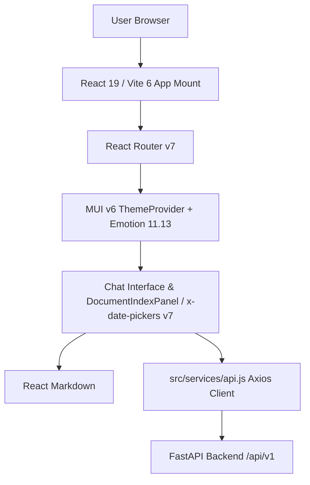

# Technical Design: UI Dependency Modernization (React 19, MUI v6, Vite 6)

## Architecture & Component Interaction
The Single Page Application preserves its existing component hierarchy and `src/services/api.js` Axios boundary while upgrading the underlying UI runtime and bundler:

## Interface Contracts & Schemas
- **Backend API Boundary (`src/services/api.js`)**: Existing Axios request/response handling is preserved unchanged (`[UNVERIFIED: sibling rag-chatbot backend /api/v1/chat and /api/v1/history contracts assumed unchanged and not modified by this UI repo]`).
- **Idempotency & Retries**: No automatic retry is added to mutating `POST` chat endpoints; standard user-initiated retry on error remains unchanged.

## Dependency & Peer Resolution Strategy
- **Exact Major Upgrades**: `react@^19.0.0`, `react-dom@^19.0.0`, `@types/react@^19.0.0`, `@types/react-dom@^19.0.0`, `@mui/material@^6.1.0`, `@mui/icons-material@^6.1.0`, `@mui/x-date-pickers@^7.22.0`, `react-router-dom@^7.0.0`, `vite@^6.0.0`, `@vitejs/plugin-react@^4.3.4`.
- **Peer Dependency Overrides**: Any third-party peer constraint mismatches (e.g., `@react-oauth/google` or Emotion React 19 peer ranges) are resolved deterministically via `package.json` `overrides` rather than `--legacy-peer-deps`.
- **Security Gate**: `npm audit --audit-level=high` verifies zero high/critical vulnerabilities in the resolved dependency tree.
- **Rollback Plan**: `git revert <commit>` restores `package.json` and `package-lock.json` cleanly.

## UI/UX Preservation & Regression Guardrails
- Existing color theme, typography, and layout breakpoints — Mobile (`<= 640px`), Tablet (`641px - 1024px`), and Desktop (`> 1024px`) — are preserved without visual redesign.
- Existing interaction states (Default, Hover/Focus, Loading, Empty, Error) are regression-tested under React 19 + MUI v6 with `axe-core` automated accessibility checks.
