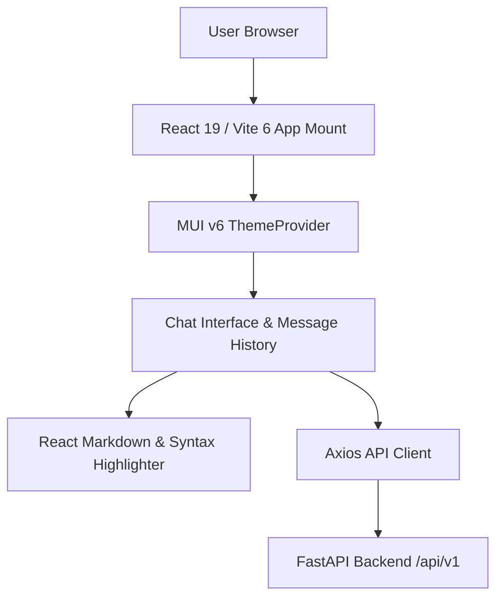

# Technical Design: Frontend Modernization (React 19 & Vite 6)

## Architecture & Component Interaction
The modern Single Page Application (SPA) renders chat interactions, message streaming, and document inspection:

## Interface Contracts & Schemas
The frontend consumes the standard REST API:
- `POST /api/v1/chat`: `{ query: string, session_id?: string, history?: array }` -> `{ answer: string, sources: array, session_id: string }`
- `GET /api/v1/history/{session_id}`: returns past conversation turns.

## External API Integration & Resilience
- **Axios HTTP Client**: Interceptor for token/session propagation, timeout limits (30s default), and automatic retry for network errors.
- **WebSocket / EventSource**: Future-proofed hooks for token streaming responses.

## UI/UX Design Specifications

### Design Direction & Grounding
- **Archetype**: High-density engineering intelligence interface with crisp typography and understated elevation.
- **Color Palette Tokens**:
  - Primary Accent: `#2563eb` (`--color-primary`)
  - Primary Hover: `#1d4ed8` (`--color-primary-hover`)
  - Background: `#0f172a` (dark mode `--color-background`), `#f8fafc` (light mode)
  - Surface: `#1e293b` (dark mode `--color-surface`), `#ffffff` (light mode)
  - Border: `#334155` (`--color-border`)
  - Text Primary: `#f1f5f9` (`--color-text-primary`)
- **Typography**:
  - Headings: `Inter, system-ui, sans-serif`, font-weight 600/700.
  - Body: `Inter, system-ui, sans-serif`, font-weight 400.
  - Code/Monospace: `JetBrains Mono, monospace`, font-size 0.875rem.

### Responsive Breakpoints
- **Mobile**: `<= 640px` (Collapsible sidebar drawer, full-width input container).
- **Tablet**: `641px - 1024px` (Compact sidebar with icon badges).
- **Desktop**: `> 1024px` (Full dual-pane layout: chat stream + reference drawer).

### 5 Mandatory Interaction States
1. **Default**: Clean conversation feed with user bubbles and assistant response cards.
2. **Hover / Focus**: 150ms ease transition on action buttons with visible 2px focus ring (`:focus-visible`).
3. **Loading Skeleton**: Shimmering placeholder cards for streaming responses (no blank screens).
4. **Empty State**: Centered prompt suggestions ("Explore docs", "Explain architecture") with clean iconography.
5. **Error Banner**: Inline alert notification with error summary and one-click "Retry Query" action.

